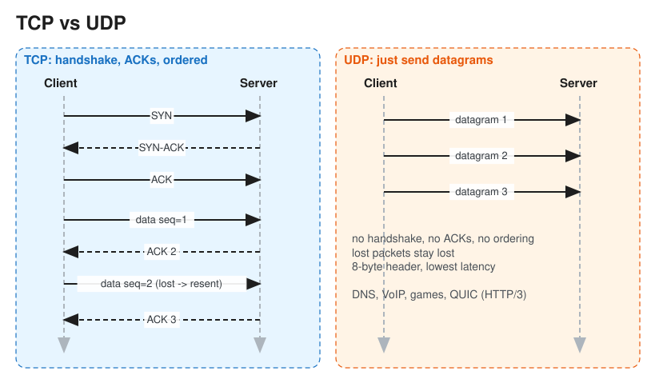

# TCP vs UDP (and HTTP/1.1 → HTTP/2 → HTTP/3)

> **TL;DR** — **TCP**: connection-oriented, reliable, ordered byte stream with flow and congestion control;
> costs a handshake and suffers head-of-line blocking. **UDP**: connectionless datagrams, no guarantees,
> minimal overhead; used where *latency beats completeness* (VoIP, gaming, DNS) or where reliability is
> rebuilt in user space (**QUIC**, which HTTP/3 uses).

## Comparison
| | TCP | UDP |
|---|---|---|
| Connection | 3-way handshake (SYN, SYN-ACK, ACK) | None |
| Reliability | ACKs + retransmission | None (fire and forget) |
| Ordering | Guaranteed (sequence numbers) | Not guaranteed |
| Flow / congestion control | Yes (sliding window; Cubic, BBR) | No (the app must behave) |
| Header | 20–60 bytes | 8 bytes |
| Unit | Byte stream (no message boundaries) | Datagrams (boundaries preserved) |
| Broadcast / multicast | No | Yes |
| Use cases | HTTP/1.1, HTTP/2, DB connections, SSH, SMTP, file transfer | DNS, VoIP, video calls (WebRTC), online games, metrics (StatsD), QUIC |

## TCP details worth knowing
* **Handshake cost**: 1 RTT for TCP, plus 1 RTT for TLS 1.3 (2 RTT for TLS 1.2) before the first byte of data.
  Mitigate with connection reuse (keep-alive, connection pools), TLS session resumption, or edge termination
  (CDN).
* **Teardown**: FIN/ACK in both directions. `TIME_WAIT` holds a closed socket for 2×MSL; many short-lived
  connections can exhaust ports. Use pooling.
* **Head-of-line (HOL) blocking**: one lost segment stalls all later data in the stream, even data belonging to
  unrelated HTTP/2 streams.
* **Nagle's algorithm**: delays small writes to batch them; disable it (`TCP_NODELAY`) for latency-sensitive
  protocols.

## HTTP evolution
| | HTTP/1.1 | HTTP/2 | HTTP/3 |
|---|---|---|---|
| Transport | TCP | TCP | **QUIC over UDP** |
| Multiplexing | No (one request at a time per connection; browsers open ~6 connections) | Many streams over one connection | Many *independent* streams |
| HOL blocking | Application-level | Fixed at HTTP level, still at TCP level | Eliminated (loss affects only its own stream) |
| Headers | Plain text | HPACK compressed, binary framing | QPACK compressed |
| Handshake | TCP + TLS | TCP + TLS | Combined transport + TLS 1.3: 1 RTT, **0-RTT** on resume |
| Connection migration | No | No | Yes (connection ID survives a Wi-Fi to cellular switch) |

## When UDP wins
* **Real-time media**: a late packet is useless, so drop it and move on (WebRTC uses SRTP over UDP).
* **Gaming state updates**: send the latest position; old ones don't matter.
* **DNS**: a single request/response that fits in one datagram; retry at the app level (falls back to TCP for
  large responses).
* **Telemetry**: losing a few metrics is fine; zero backpressure on the app.

## Interview follow-ups
* *"Why did HTTP/3 move to UDP?"* TCP is implemented in OS kernels and middleboxes, which makes it nearly
  impossible to evolve. QUIC implements reliability, congestion control and encryption in user space over UDP,
  which fixes HOL blocking and speeds up handshakes.
* *"Chat app: TCP or UDP?"* TCP (WebSocket); messages must arrive and be ordered. Video calls in the same app
  use UDP.
* *"What happens when you type a URL?"* DNS lookup, then the TCP (or QUIC) handshake, the TLS handshake, the HTTP
  request, the server (via LB, app, DB), the response, and rendering. See [DNS](dns.md) and
  [OSI Model](osi_model.md).

# References
* https://github.com/karanpratapsingh/system-design#tcp-and-udp
* https://github.com/donnemartin/system-design-primer#transmission-control-protocol-tcp
* https://www.cloudflare.com/learning/performance/what-is-http3/
* https://hpbn.co/ (High Performance Browser Networking, Ilya Grigorik)
