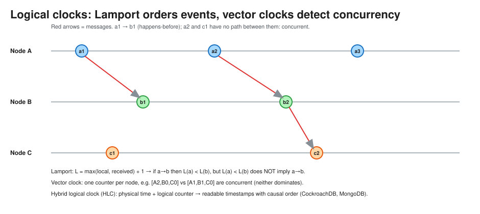

# Time & Ordering in Distributed Systems

> **TL;DR** — There is **no single global clock**. Physical clocks drift and skew (NTP keeps them within ms-tens of ms, never perfectly), so you can't order events across machines by
> wall-clock timestamps alone. Distributed systems order events by **causality** instead: **Lamport clocks** (a scalar that respects happened-before), **vector clocks** (detect concurrent
> updates), **hybrid logical clocks (HLC)** (physical time + logical counter), or by **bounding clock uncertainty** (Google **TrueTime**, used by Spanner). Choose by need: total order via a single
> leader/sequencer, causal order via logical clocks, or real-time consistency via bounded-uncertainty clocks. Related: [Consistency](consistency.md), [Unique ID generator](../problems/unique_id_generator.md), [Consensus](consensus.md).

## Why wall-clock time fails
- **Clock drift**: quartz oscillators drift (~tens of ppm → seconds per day if unsynced). **NTP** corrects to roughly 1-50 ms over the internet, better in a datacenter; steps/slews can make time **jump backwards**.
- **Skew** between nodes means "event A at 12:00:00.005 on node 1" vs "event B at 12:00:00.003 on node 2" proves nothing about order.
- **Leap seconds**, VM pauses, GC stalls, and suspended laptops all break assumptions.
- Consequences: **last-write-wins (LWW)** can silently drop the *actual* latest write; lease/lock expiry based on local clocks causes split-brain unless fenced ([Distributed locking](distributed_locking.md), [Leader election](leader_election.md)); timeout-based failure detection is only a guess ([Heartbeats](heartbeats.md)).
- Monotonic clocks (`CLOCK_MONOTONIC`) are fine for **measuring durations on one node**, not for comparing across nodes.

## Happened-before (causality)
`a → b` if (1) same process and `a` before `b`, (2) `a` is a send and `b` its receive, or (3) transitive. If neither `a → b` nor `b → a`, the events are **concurrent**. Causal order is what users
perceive as "reply after the question".

## Logical clocks
### Lamport clock
- Each process keeps a counter `L`. Increment on each local event; on send attach `L`; on receive set `L = max(L, received) + 1`.
- Guarantee: **`a → b ⇒ L(a) < L(b)`**. The converse is false (can't tell concurrent from ordered). Break ties with node id to get a **total order** (used in total-order broadcast, distributed mutual exclusion).

### Vector clock
- A vector of counters, one per node; increment own entry on events, merge with element-wise max on receive. Compare: `V1 < V2` if all ≤ and one <; otherwise **concurrent**.
- Detects **conflicts** for multi-leader/leaderless stores (Dynamo, Riak siblings) so the app or a CRDT can merge ([Replication](data_replication.md)). Cost: size grows with number of writers (prune, dotted version vectors).
- **Version vectors** are the same idea applied to data versions (per replica), not events.

### Hybrid Logical Clock (HLC)
- Timestamp = (physical time `pt`, logical counter `c`): `pt` follows wall time but never goes backwards and absorbs received timestamps; `c` breaks ties. Gives **causality-respecting timestamps close to real time**, in a bounded-size value.
- Used by CockroachDB, YugabyteDB, MongoDB (cluster time), Cassandra LWT variants. Great for MVCC snapshots and `AS OF` queries.

## Bounded-uncertainty clocks (TrueTime)
- **TrueTime API** returns an interval `[earliest, latest]` guaranteed to contain true time (GPS + atomic clocks; uncertainty ~ms). **Spanner** assigns commit timestamps and performs **commit-wait**: delay
  acknowledging until the timestamp is definitely in the past → **external consistency** (strict serializability) across the globe ([CAP/PACELC](cap_theorem.md)).
- Cloud analogues: Amazon Time Sync Service / clock-bound libraries expose error bounds; Aurora DSQL uses time-based snapshots ([Aurora DSQL](aurora_dsql.md)).

## Ordering guarantees (what you can choose)
| Order | Mechanism | Cost |
|---|---|---|
| **Total order** | Single leader/sequencer, Raft/Paxos log, Kafka partition | Throughput bottleneck / coordination ([Consensus](consensus.md)) |
| **Causal order** | Lamport/vector/HLC; causal broadcast | Metadata per message; no global order |
| **Per-key / per-partition order** | Partition by key; one writer per key | Cross-key order lost ([Kafka](kafka.md)) |
| **Real-time (linearizable)** | Leader reads, consensus, TrueTime commit-wait | Latency ([Consistency](consistency.md)) |
| **No order (eventual)** | LWW, CRDTs | Conflicts resolved by merge |

## Practical patterns
- **Generate sortable IDs**: Snowflake/ULID/UUIDv7 embed time + worker + sequence; k-sortable, but still rely on clocks (handle backwards time by waiting or refusing) ([Unique ID generator](../problems/unique_id_generator.md)).
- **Event time vs processing time** in streams: use **watermarks** to decide when a window is complete and handle late events ([Flink](flink.md), [Flink vs Spark](flink_vs_spark.md)).
- **Fencing tokens**: monotonically increasing numbers issued with each lock/lease; storage rejects stale tokens regardless of clocks.
- **Optimistic concurrency / version numbers** instead of timestamps for conflict detection ([Transactions](transactions.md)).
- **Chat ordering**: per-conversation sequence assigned by the owning shard rather than client clocks ([Chat](../problems/chat_system.md)).
- **Read-your-writes** via session tokens carrying the last-seen version/timestamp.

## Pitfalls
- LWW by wall-clock timestamps; assuming NTP-synced means equal; lease-based locks without fencing; using client clocks; comparing monotonic clock readings across hosts; unbounded vector-clock growth.

## Interview follow-ups
- *"How do you order messages in a chat across devices?"* Server-assigned per-conversation sequence numbers (single writer per conversation), not client timestamps.
- *"Lamport vs vector clock?"* Lamport: cheap total order consistent with causality but can't detect concurrency; vector: detects concurrency, O(N) size.
- *"How does Spanner get global consistency?"* TrueTime bounds uncertainty; commit-wait ensures timestamp order matches real-time order.
- *"Is LWW safe?"* Only when losing concurrent writes is acceptable and clocks are well bounded; otherwise use versions/CRDTs.

# References
* [Time, Clocks, and the Ordering of Events in a Distributed System (Lamport, 1978)](https://lamport.azurewebsites.net/pubs/time-clocks.pdf)
* [Spanner: Google's Globally-Distributed Database](https://static.googleusercontent.com/media/research.google.com/en//archive/spanner-osdi2012.pdf)
* [Logical Physical Clocks (HLC paper)](https://cse.buffalo.edu/tech-reports/2014-04.pdf) · Designing Data-Intensive Applications, Chapters 8-9
