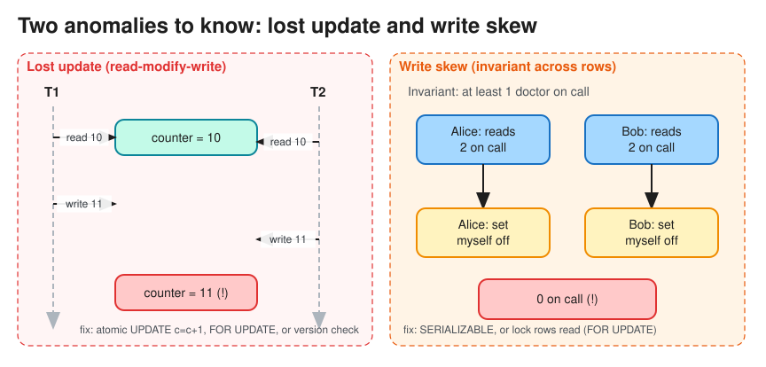

# Transactions, ACID & Isolation Levels

> **TL;DR** — A transaction groups reads and writes into one unit that **all happens or none happens**. ACID =
> **Atomicity** (all or nothing, via an undo/redo log), **Consistency** (application invariants hold),
> **Isolation** (concurrent transactions don't see each other's partial work), **Durability** (committed data
> survives crashes, via WAL + fsync + replication). Isolation comes in levels; weaker levels allow specific
> **anomalies**. For transactions that span services or databases, see
> [Distributed Transactions](distributed_transactions.md).

## ACID
| Property | Meaning | Implemented by |
|---|---|---|
| **Atomicity** | On failure, partial writes are rolled back | Write-ahead log (WAL), undo log |
| **Consistency** | The DB moves from one valid state to another (constraints, FKs, app invariants) | Constraints + correct application logic (the "C" is mostly the app's job) |
| **Isolation** | Concurrent transactions behave as if run in some order | Locks (2PL) or MVCC snapshots, SSI |
| **Durability** | Once committed, the data isn't lost | WAL fsync before ack, replication, backups |

**BASE** (typical of NoSQL): **B**asically **A**vailable, **S**oft state, **E**ventual consistency. It trades
isolation and immediacy for availability and scale.

## Read/write anomalies

| Anomaly | What happens | Example |
|---|---|---|
| **Dirty read** | Read another transaction's *uncommitted* data | T1 sets balance=0, T2 reads 0, T1 rolls back |
| **Dirty write** | Overwrite another's uncommitted write | Two buyers' writes interleave on an invoice |
| **Non-repeatable read** (read skew) | Same row read twice gives different values | A report sees an account before and after a transfer |
| **Phantom read** | Same *range query* returns new rows | `COUNT(*) WHERE room=5` changes mid-transaction |
| **Lost update** | Two read-modify-write cycles; one overwrites the other | Two `counter = counter + 1` both read 10 and write 11 |
| **Write skew** | Two transactions read overlapping data, write *different* rows, and together break an invariant | Two doctors both go off-call because each saw the other on call |

## Isolation levels (SQL standard + practice)
| Level | Dirty read | Non-repeatable read | Phantom | Lost update / write skew | Notes |
|---|---|---|---|---|---|
| Read Uncommitted | possible | possible | possible | possible | Rarely used |
| **Read Committed** | prevented | possible | possible | possible | **Postgres / Oracle / SQL Server default** |
| **Repeatable Read / Snapshot Isolation** | prevented | prevented | mostly prevented (MVCC snapshot) | lost update prevented (PG); **write skew possible** | **MySQL InnoDB default** (RR) |
| **Serializable** | prevented | prevented | prevented | prevented | 2PL (locks), or **SSI** (Postgres) / Spanner |

## How isolation is implemented
* **Two-phase locking (2PL)**: shared locks for reads, exclusive locks for writes, all held until commit.
  It gives serializability but blocks readers and can deadlock (detect the cycle, abort the victim).
* **MVCC**: each write creates a new row *version*; each transaction reads from a consistent snapshot, so
  readers never block writers. Old versions need garbage collection (Postgres `VACUUM`).
* **Serializable Snapshot Isolation (SSI)**: MVCC plus tracking of read/write dependencies; aborts transactions
  that would form a cycle. Optimistic: no blocking, but retries on conflict.

## Preventing lost updates and write skew in application code
* **Atomic operations**: `UPDATE stock SET qty = qty - 1 WHERE id=? AND qty > 0`.
* **Pessimistic locking**: `SELECT ... FOR UPDATE` (locks the rows read).
* **Optimistic concurrency control**: a `version` column; `UPDATE ... SET v=v+1 WHERE id=? AND v=?`, retry if
  0 rows changed. Good when contention is low.
* **Materialize the conflict**: create a lockable row (e.g. a `slots` table) so write skew becomes a row
  conflict.
* **Unique constraints**: let the DB enforce "no double booking" (`UNIQUE(room_id, date)`).

## Interview follow-ups
* *"Ticketmaster: two users grab the same seat."* Use `UPDATE seats SET status='HELD', holder=?, expires=now()+10m
  WHERE id=? AND status='AVAILABLE'` (atomic conditional write), or a distributed lock with a TTL, plus a unique
  constraint on the final booking.
* *"Why not always use Serializable?"* Throughput and latency: more aborts and retries, more lock waits.
  Use it for the small set of critical paths (money movement).
* *"How is durability guaranteed if the machine dies right after commit?"* The WAL is fsynced before the ack,
  synchronous replication to at least one replica, and point-in-time recovery from WAL archives.

# References
* Designing Data-Intensive Applications, Chapter 7: Transactions
* https://en.wikipedia.org/wiki/ACID
* https://www.postgresql.org/docs/current/transaction-iso.html
* https://blog.bytebytego.com/p/a-crash-course-on-relational-database
* https://jepsen.io/consistency
