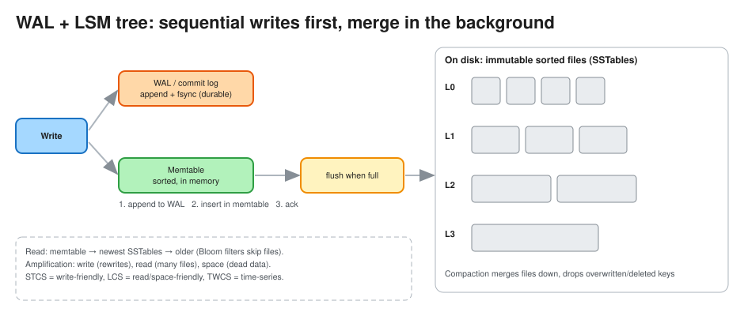

# Write-Ahead Log (WAL) and LSM Compaction

> **TL;DR** — The **write-ahead log** is the foundation of durability: **append the change to a sequential log (and fsync) *before* applying it**, so after a crash you can **replay** the log. Databases
> use it for crash recovery and replication; Kafka *is* a log. **LSM trees** combine a WAL with an in-memory **memtable** that flushes to immutable sorted **SSTables**, merged in the background by
> **compaction**. Compaction strategy trades **write amplification, read amplification and space amplification**. This note covers WAL mechanics and compaction (B-tree vs LSM basics are in
> [Database Indexes](database_indexing.md)). See also [Cassandra](cassandra.md), [DynamoDB](dynamodb.md), [Postgres & MySQL](postgres_mysql.md).

## Write-ahead logging
- **Rule**: a change must be durably in the log **before** the modified data page can be written to disk. Sequential appends are much faster than random page writes.
- **Commit** = log record(s) flushed (`fsync`) → acknowledge. Data pages are flushed lazily by background writers/checkpoints. **Group commit** batches many transactions' log flushes into one fsync.
- **Recovery** (ARIES-style): *analysis* (find dirty pages/active txns) → **redo** (reapply logged changes after the last checkpoint) → **undo** (roll back uncommitted transactions). **Checkpoints** bound recovery time by marking a point where all earlier changes are on disk.
- **Log record** types: physical (page diffs), logical (row operations), or physiological; each has a **LSN** (log sequence number) used for ordering, idempotent redo (page LSN comparison) and replication positions.
- **Uses beyond recovery**:
  - **Replication**: ship the WAL to followers (Postgres streaming replication, MySQL binlog/redo) ([Replication](data_replication.md)).
  - **CDC**: logical decoding of the WAL to Kafka (Debezium) ([Event sourcing/CQRS/CDC](event_sourcing_cqrs_cdc.md)).
  - **Point-in-time recovery (PITR)**: base backup + archived WAL.
  - **Atomicity**: rollback via undo information; used by file systems (journaling), Kafka (commit log), etcd/Raft (replicated log), LSM stores (commit log), message brokers.
- **Durability knobs**: `fsync` per commit (safest) vs batched/async (`synchronous_commit=off`, `innodb_flush_log_at_trx_commit=2`, Cassandra `commitlog_sync: periodic`) trade latency for a small loss window.
- **Pitfalls**: disks/VMs that lie about fsync, write caches without battery/capacitor, full log volume stalling writes, long transactions pinning old WAL, replication slots that retain WAL forever.

## LSM tree write and read path
1. **Write**: append to the **WAL/commit log** → insert into the **memtable** (sorted, in memory) → ack.
2. **Flush**: when the memtable is full, write it as an immutable sorted **SSTable** (sequential I/O), then retire the corresponding WAL segment.
3. **Read**: check memtable → SSTables from newest to oldest; **Bloom filters** skip files that can't contain the key; sparse indexes locate blocks ([Bloom filters](bloom_filter.md)). Newest version wins.
4. **Delete**: write a **tombstone** (a marker); the data is physically removed during compaction after a grace period (`gc_grace_seconds` in Cassandra) ([Cassandra](cassandra.md)).
5. **Compaction**: merge SSTables, drop overwritten values and expired tombstones, restore read performance.

## Amplification: the trade-off triangle
| | Meaning | Hurts when |
|---|---|---|
| **Write amplification** | Bytes written to disk per byte of user data (compaction rewrites data multiple times) | SSD wear, throughput ceilings |
| **Read amplification** | SSTables/pages touched per read | Many overlapping files |
| **Space amplification** | Disk used ÷ live data (obsolete versions waiting for compaction) | Disk fills, temporary 2x during compaction |

## Compaction strategies
| Strategy | How | Write amp | Read amp | Space amp | Best for |
|---|---|---|---|---|---|
| **Size-tiered (STCS)** | Merge similar-sized SSTables when N accumulate | **Low** | Higher (many overlapping files) | High (needs up to ~2× free space) | Write-heavy, insert-mostly workloads |
| **Leveled (LCS)** | Levels with 10× size ratio; each level is non-overlapping sorted runs; compact one file into the next level | High (~10-30×) | **Low** (≈ 1 file per level) | **Low** | Read-heavy, point lookups, update-heavy with space limits (RocksDB/LevelDB default) |
| **Time-window (TWCS)** | Group SSTables by time window, compact within window, drop whole windows on TTL | Low | Good for time-bounded reads | Low with TTL | **Time-series / TTL data** |
| **Unified (UCS)** | Parameterized tiered↔leveled spectrum (Cassandra 5) | Tunable | Tunable | Tunable | General |
| **FIFO** | Drop oldest files | Minimal | n/a | Bounded | Caches, ephemeral logs |
- **Universal knobs**: compaction throughput limits (avoid starving foreground I/O), compaction threads, **write stalls** when L0 backs up (RocksDB), rate-limiting.
- **Tombstone trouble**: heavy deletes + reads spanning many tombstones = slow scans ("tombstone hell"); avoid delete-heavy queue patterns; TTL/TWCS helps.

## B-tree vs LSM (quick)
| | B-tree (Postgres, InnoDB) | LSM (Cassandra, RocksDB, DynamoDB internals) |
|---|---|---|
| Writes | Random in-place page updates + WAL | Sequential (WAL + memtable + flush); compaction later |
| Reads | ~1 index traversal | May check several files (mitigated by Bloom filters + compaction) |
| Write amp | Moderate (page rewrites + WAL) | Compaction-driven, can be high |
| Space | Fragmentation | Temporary duplicates |
| Best | Read-heavy, range scans, transactions | Write-heavy, ingest, time-series |
(Full comparison: [Database Indexes](database_indexing.md).)

## Interview use
- Explain **why writes are fast** in Cassandra/RocksDB (sequential WAL + memtable) and **why reads need care** (SSTable fan-out, Bloom filters, compaction).
- Explain **durability vs latency** knobs and how replicas get the WAL.
- Choose compaction by workload: *write-heavy time-series with TTL → TWCS; read-heavy KV → leveled; bursty ingest → size-tiered.*
- Mention **write stalls/backpressure** when compaction can't keep up ([Backpressure](backpressure_load_shedding.md)).

## Interview follow-ups
- *"What happens if the process crashes after acknowledging a write?"* Replay the WAL/commit log on restart (data in the memtable is reconstructed); only the un-synced tail can be lost under async fsync.
- *"Why do LSM stores need Bloom filters?"* To avoid reading every SSTable for keys that don't exist or live in one file.
- *"Compaction is hurting latency."* Throttle compaction, add I/O headroom, tune strategy, increase memtable size, spread nodes, schedule heavy compactions off-peak.
- *"How does the WAL relate to Raft/Kafka?"* Same idea: an ordered, durable, append-only log is the source of truth; state = replay of the log ([Consensus](consensus.md), [Kafka](kafka.md)).

# References
* [ARIES (Mohan et al.)](https://cs.stanford.edu/people/chrismre/cs345/rl/aries.pdf), [PostgreSQL WAL internals](https://www.postgresql.org/docs/current/wal-intro.html)
* [The Log-Structured Merge-Tree (O'Neil et al.)](https://www.cs.umb.edu/~poneil/lsmtree.pdf), [RocksDB compaction wiki](https://github.com/facebook/rocksdb/wiki/Compaction)
* Designing Data-Intensive Applications, Chapter 3
