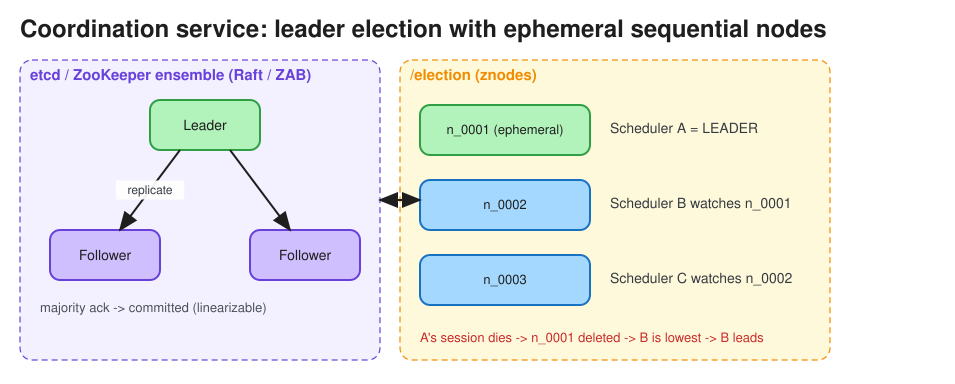

# Coordination Services (ZooKeeper, etcd, Consul)

> **TL;DR** — A coordination service is a small, **strongly consistent**, highly available key-value store
> (replicated by consensus: ZAB or Raft) that distributed systems use for **leader election, distributed locks,
> configuration, service discovery, membership, and metadata**. Keep only *small, critical* data there, never
> bulk data. Main primitives: **ephemeral nodes / leases** (they disappear when the client dies), **watches**
> (change notifications), and **compare-and-set / sequence numbers**.

## Why not just use your database?
Coordination needs (a) linearizable writes, (b) fast failure detection tied to client sessions, and (c) push
notifications on change. Implementing those correctly on top of a general DB is error-prone. Coordination
services give you all three as tested primitives.

## Comparison
| | ZooKeeper | etcd | Consul |
|---|---|---|---|
| Consensus | ZAB (Paxos-like) | Raft | Raft |
| Data model | Hierarchical znodes (`/app/leader`) | Flat key space, prefix ranges, MVCC revisions | KV + service catalog |
| Liveness | Session + **ephemeral znodes** | **Leases** with TTL attached to keys | Sessions + health checks |
| Notifications | One-shot watches (re-register) | Streaming watches from a revision | Blocking queries |
| Used by | Kafka (pre-KRaft), HBase, Hadoop, Solr | **Kubernetes**, CoreDNS, many cloud-native systems | Service mesh / discovery (HashiCorp stack) |

## Classic recipes
* **Leader election**: every candidate creates an ephemeral sequential znode `/election/n_000000X`; the lowest
  number is the leader. Each other node watches *only its predecessor* (which avoids the thundering herd).
  When the leader's session dies, its znode vanishes and the next node takes over. In etcd: `Campaign()` using
  a lease.
* **Distributed lock**: the same pattern under `/locks/resource`. Pair it with **fencing tokens** (the znode
  sequence number or etcd revision) so a paused old holder can't corrupt state. See
  [Distributed Locking](distributed_locking.md).
* **Configuration**: services read `/config/app` and watch it for hot reload.
* **Group membership / service discovery**: each instance registers an ephemeral node; clients list and watch.
  See [Service Discovery](service_discovery.md).
* **Barriers and counters**: sequential nodes and conditional updates.

## Guarantees and limits
* Writes go through the leader and are linearizable. ZooKeeper reads are served locally by any server, so they
  can be stale; call `sync()` first for linearizable reads. etcd reads are linearizable by default (with a
  serializable option).
* Cluster sizes of **3 or 5** nodes tolerate 1 or 2 failures. More nodes means *slower* writes, because a
  majority must ack.
* Throughput is in the thousands to tens of thousands of writes/sec, and data size is small (etcd default quota
  is 2 GB). Don't use it as a general DB or a message queue.
* A session timeout that is too short causes false failovers during GC pauses or network blips; too long means
  slow failover.

## Interview follow-ups
* *"How does the scheduler avoid two masters?"* Leader election through etcd/ZooKeeper plus fencing tokens
  checked by workers or storage.
* *"Kafka removed ZooKeeper. Why?"* KRaft moves metadata into an internal Raft-replicated log inside Kafka. That
  means one system to operate, faster controller failover, and support for many more partitions.

# References
* [ZooKeeper: Wait-free coordination for Internet-scale systems](https://www.usenix.org/legacy/event/usenix10/tech/full_papers/Hunt.pdf)
* [The Chubby lock service for loosely-coupled distributed systems](https://static.googleusercontent.com/media/research.google.com/en//archive/chubby-osdi06.pdf)
* https://zookeeper.apache.org/doc/current/recipes.html
* https://etcd.io/docs/latest/learning/why/
