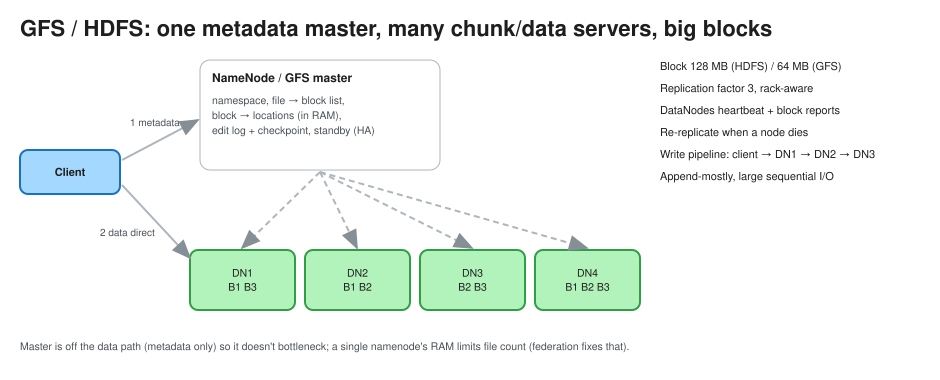

## Problem Statement
Design a **distributed file system** (like GFS / HDFS) that stores very large files (GBs-TBs) across thousands of commodity machines, tolerates frequent disk and node failures, and serves
high-throughput sequential reads and appends for batch analytics ([MapReduce](../basics/mapreduce.md), [Spark](../basics/spark.md)).

## Clarification Questions to Interviewer
- Workload: large files, sequential scans and appends (not random small writes)? **Yes**: write-once-read-many, append.
- Scale: petabytes, ~10^3-10^4 nodes, ~10^8 files?
- Consistency: can clients tolerate relaxed consistency for concurrent appends? POSIX needed? (No.)
- Durability target (11 nines?) and availability during node/rack loss?
- Multi-tenant, quotas, permissions? Multi-datacenter?

## Requirements
### Functional Requirements
- Create/delete files and directories; **read** (streaming, offset), **append** to existing files; list/stat; rename.
- Files split into large **chunks/blocks** (64-256 MB) stored on many nodes.
- Namespace with directories, permissions, quotas.
#### Below the line (out of scope)
- POSIX random writes, hard links, multi-writer strong semantics, erasure-coding internals, cross-region replication.

### Non-Functional Requirements
- **High throughput** for large sequential I/O over low latency.
- **Fault tolerance**: node/disk/rack failures are routine; automatic re-replication.
- **Durability**: replicate (3×) across racks, or erasure code for cold data.
- **Scalability**: add nodes without downtime; metadata must not become the bottleneck.
- **Consistency**: single-writer/append semantics, atomic record append at-least-once (GFS) or strict single writer (HDFS).
#### Below the line (out of scope)
- Fine-grained ACLs, snapshots across clusters, tiering policy details.

## Back of Envelope Estimations/Capacity Estimation & Constraints
- 100 PB logical × 3 replicas = 300 PB raw; at 20 TB per node → ~15,000 nodes (use denser nodes → fewer).
- Block size 128 MB → 100 PB / 128 MB ≈ 800M blocks. Metadata ≈ 150-200 B/block → ~150 GB RAM for block map: fits in one big master's memory (HDFS NameNode scale limit; federation shards the namespace).
- Small files hurt: 100M tiny files = 100M inodes + blocks in master memory regardless of bytes ([Back-of-envelope](../basics/back_of_envelope_estimation.md)).
- Re-replication after a node loss: a 20 TB node must be rebuilt from surviving replicas; throttle to avoid saturating the network.

## High-level API design
```
create(path) → fileId                     delete(path)             rename(src, dst)
open(path) → [blockId, replicas…]         read(blockId, offset, len) ← from DataNode directly
append(path, bytes) → offset              getFileInfo(path)        list(dir)
```
Client library hides the protocol: ask master for block locations, then stream data directly with chunkservers.

## Data Model
- **Namespace (master)**: `inode(fileId, path, perms, mtime, blocks[])`, directory tree, persisted as an **edit log (WAL) + periodic checkpoints (fsimage)** ([WAL](../basics/wal_lsm.md)).
- **Block map**: `blockId → [replica locations]`, version/generation stamp, length. **Not persisted**; rebuilt from **block reports** at startup.
- **DataNode (chunkserver)**: stores blocks as local files + checksums per 64 KB ([Checksums](../basics/checksums.md)).

## High Level System Design


- **Single master (NameNode)** holds namespace + block map in memory; chunkservers (DataNodes) hold the data. Control plane separate from data plane so the master is not on the data path.
- **Read**: client asks master for block locations → reads from the **closest replica** (same node/rack) → verifies checksum; on mismatch tries another replica and reports corruption.
- **Write/append pipeline**: master picks 3 replicas (rack-aware: 1 local rack, 2 on a different rack); client streams data to the first replica, which **pipelines** to the next (chain replication to use full network bandwidth); acks flow back; a primary/lease holder orders concurrent appends (GFS lease) ([Replication](../basics/data_replication.md)).
- **Heartbeats + block reports** from DataNodes ([Heartbeats](../basics/heartbeats.md)); missing heartbeats → mark dead → master schedules **re-replication** of under-replicated blocks.
- **Master HA**: standby NameNode tails the edit log via a quorum journal (QJM) or shared storage; **ZooKeeper** failover controller + **fencing** to prevent split-brain ([Leader election](../basics/leader_election.md), [ZooKeeper](../basics/zookeeper.md)).

## Deep Dive
### Why large blocks
Fewer metadata entries, fewer client-master interactions, long sequential reads amortize seeks, persistent TCP connections. Cost: small files waste metadata; hot small files may overload one chunkserver.

### Replica placement and rack awareness
Default 3 replicas: writer's node (or random), another rack, a different node on that second rack. Survives rack failure with only one cross-rack transfer in the write pipeline. Balance disk usage with a **balancer**.

### Consistency model
Single writer per file (HDFS) or leased primary ordering mutations (GFS). Appends are atomic; GFS **record append** may leave padding/duplicates so readers must tolerate duplicates (checksums, unique ids). Reads see data after `hflush/hsync`.

### Failure handling
- **DataNode failure**: detected by missed heartbeats (~10 min HDFS default); re-replicate blocks from surviving copies, prioritizing blocks with fewest replicas.
- **Corruption**: per-chunk checksums verified on read and by background **scrubbing**; corrupt replicas deleted and re-replicated.
- **Master failure**: standby takes over from the shared edit log; block locations re-learned from block reports (safe mode on startup).
- **Network partition**: lease expiry and fencing stop stale writers.

### Metadata scalability
Master memory is the limit: use **federation** (multiple namespaces/NameNodes over shared DataNodes), larger blocks, file consolidation (SequenceFile/Parquet/HAR), or a distributed metadata store (Colossus/Tectonic use sharded metadata in Bigtable/ZippyDB-like stores).

### Erasure coding
Replace 3× replication with Reed-Solomon (e.g. 6+3 = 1.5× overhead) for cold data; costs CPU and degraded-read/rebuild bandwidth. Keep hot data replicated ([Blob storage](../basics/blob_storage.md)).

### Pitfalls
- Small-file explosion; master as bottleneck; treating it like a POSIX FS; re-replication storms saturating the network; ignoring slow disks ("gray failures").

## References
* [The Google File System (SOSP 2003)](https://research.google/pubs/the-google-file-system/), [HDFS Architecture](https://hadoop.apache.org/docs/stable/hadoop-project-dist/hadoop-hdfs/HdfsDesign.html)
* [Colossus / Tectonic (Meta) paper](https://www.usenix.org/conference/fast21/presentation/pan) · [MapReduce](../basics/mapreduce.md)
